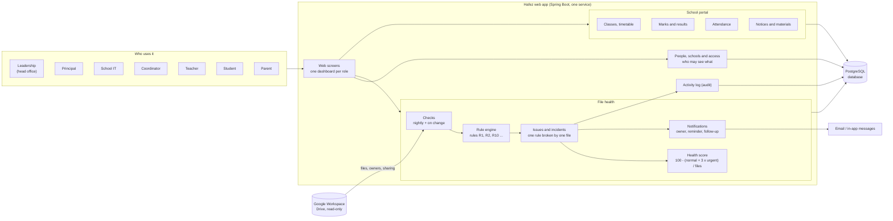
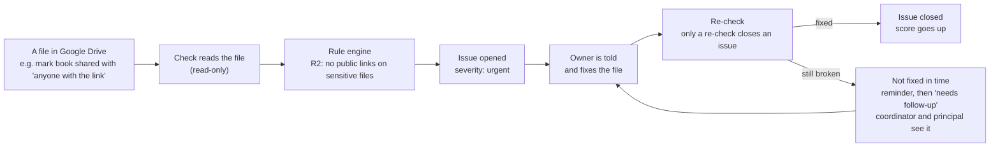
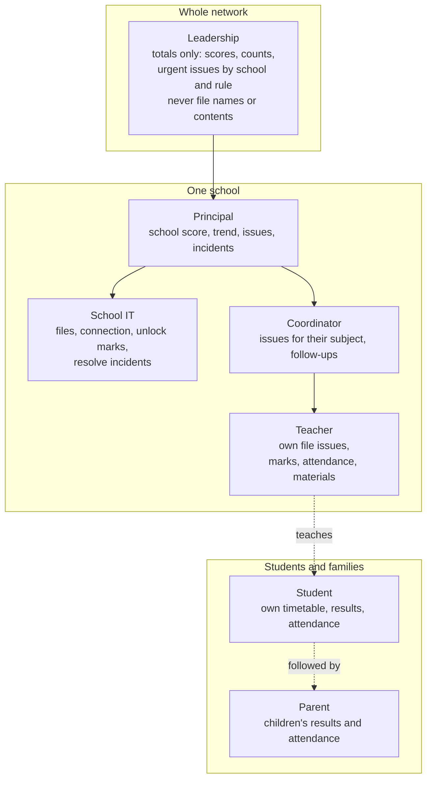
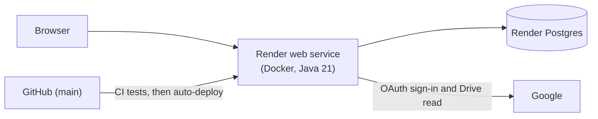

# Hafez at a glance

Block diagrams written in [Mermaid](https://mermaid.js.org). GitHub, VS Code (Markdown preview with a Mermaid extension) and
https://mermaid.live all draw them from the code below.

## 1. The big picture

Hafez watches the files in each school's Google Drive, checks them against rules, and tells the right person what to fix.
It also runs a small school portal (classes, marks, attendance, notices).

## 2. How a problem travels (the heart of the system)

## 3. Who sees what

## 4. Where it runs

### Reading tip for new users
Start with diagram 2: everything else exists to support that loop. Diagram 1 shows the parts, diagram 3 shows who gets
which view, diagram 4 shows where it is hosted.
